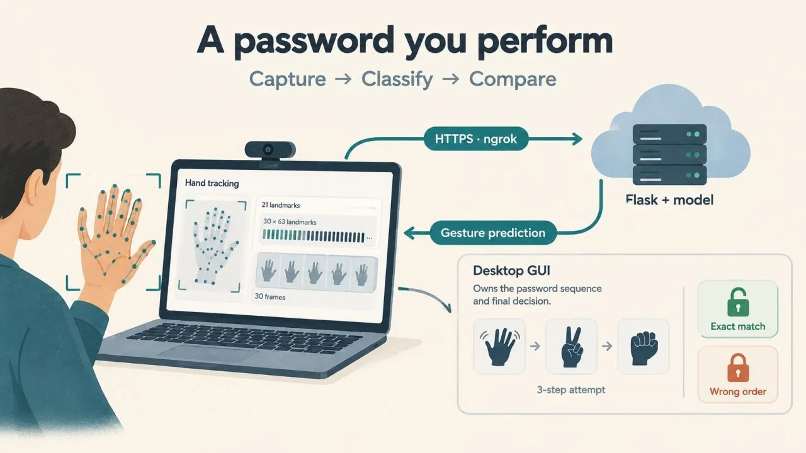

# Gesture Password Access Control

Gesture-based access control prototype using MediaPipe hand tracking, a GRU classifier, Flask, and a desktop GUI.

<p align="center">
  
</p>


## Overview

This project implements a gesture-based password system that combines computer vision, sequence modeling, and a local desktop interface.  
A user performs a sequence of hand gestures in front of a webcam, and access is granted only when the predicted gesture sequence exactly matches the configured password order.

The project demonstrates how vision-based interaction, ML inference, and application logic can be combined into a small but realistic authentication workflow.

## How It Works

1. The desktop GUI captures a short webcam gesture clip.
2. MediaPipe extracts 3D hand landmarks for each frame. MediaPipe Hands detects 21 hand landmarks, which become a 63-value feature vector per frame using \((x, y, z)\) coordinates [web:480][web:486].
3. The landmark sequence is sent to a Flask inference API.
4. A GRU-based model predicts the gesture class.
5. The GUI appends the predicted class to the current password sequence.
6. Access is granted only if the final sequence exactly matches the configured password order.

## Features

- Desktop GUI built with Tkinter.
- Real-time webcam preview using OpenCV.
- Hand landmark extraction with MediaPipe Hands.
- GRU-based gesture classification with TensorFlow/Keras.
- Flask-based inference API.
- Optional ngrok exposure for public API access and remote testing [web:493].
- Exact sequence matching for gesture-password verification.
- Resettable sequence state from the GUI.

## Gesture Configuration

### Supported gesture labels
- `wave`
- `peace sign`
- `fist`

### Configured password
```python
PASSWORD_ORDER = 
# wave -> peace sign -> fist
```

## System Architecture

### GUI layer
- Captures 2-second gesture clips from the webcam.
- Extracts hand landmarks from video frames.
- Displays the current sequence, prediction result, and access status.

### Inference layer
- Flask API receives the current sequence and landmark tensor.
- Loads the trained `gesture_classifier.h5` model.
- Returns the predicted gesture class and sequence status.

### Password logic
- The predicted gesture IDs are appended in order.
- Access is granted only on an exact sequence match.
- This design avoids accidental acceptance from partial or loosely similar sequences.

## Tech Stack

- **Language:** Python
- **GUI:** Tkinter
- **Vision:** OpenCV, MediaPipe Hands
- **Modeling:** TensorFlow / Keras, GRU
- **API:** Flask
- **Tunneling:** ngrok for optional public exposure [web:493]

## Project Structure

```text
data/                     # Gesture data and supporting assets
notebooks/                # Experiments and model development
gesture_gui_http.py       # Desktop GUI with webcam + HTTP client
gesture_gui.py            # Local GUI variant
gesture_gui_tf.py         # TensorFlow-based GUI variant
model_infer.py            # Inference logic
gesture_classifier.h5     # Trained GRU model
test_locally.py           # Local testing helper
test_offline.py           # Offline testing helper
README.md
```

## Installation

### 1. Clone the repository
```bash
git clone https://github.com/ali76-AFK/Gesture-Password-Access-Control.git
cd Gesture-Password-Access-Control
```

### 2. Create a virtual environment
```bash
python3 -m venv venv
source venv/bin/activate
```

### 3. Install dependencies
```bash
pip install --upgrade pip
pip install -r requirements.txt
```

## Run the Project

### Start the inference API
```bash
python model_api.py
```

### Update the GUI API URL
Set the ngrok or local API URL inside `gesture_gui_http.py`.

### Start the GUI
```bash
python gesture_gui_http.py
```

## Security Notes

- Do not commit your real ngrok auth token to GitHub.
- Rotate the token immediately if it has ever been exposed publicly.
- This project is a prototype for portfolio and learning purposes, not a production authentication system [web:493].

## What This Project Demonstrates

- Hand landmark extraction from live video.
- Sequence classification with a GRU model.
- Real-time interaction between desktop UI and inference API.
- Practical application of computer vision to authentication-style workflows.
- Integration of local ML inference with user-facing application logic.

## Future Improvements

- Replace ngrok dependency with a local-only or deployable inference service.
- Add more gesture classes and user-specific personalization.
- Improve robustness under lighting variation and occlusion.
- Add confidence thresholds and retry logic.
- Evaluate security tradeoffs against other biometric approaches.
